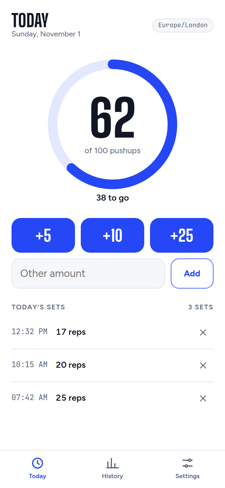
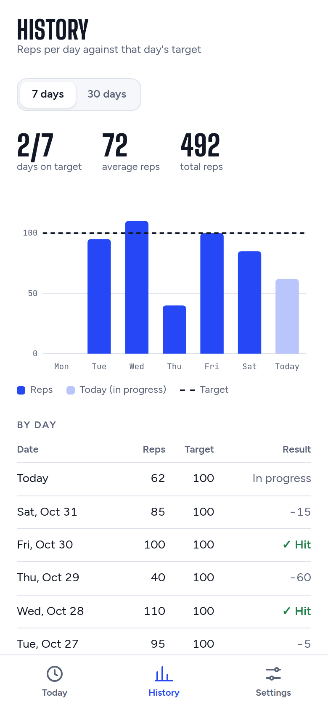
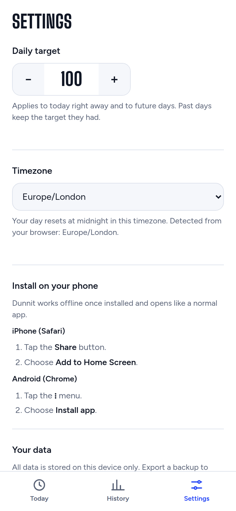
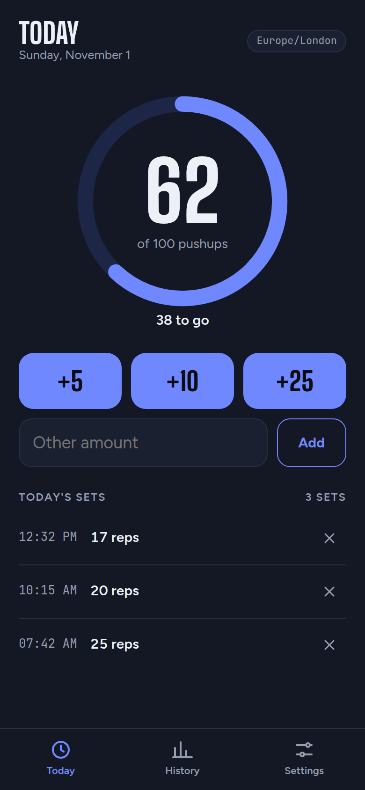
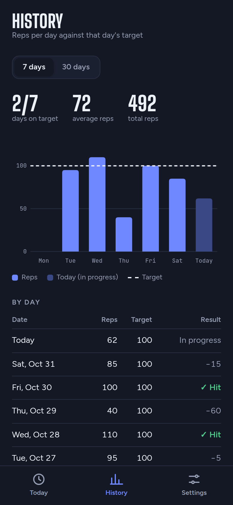
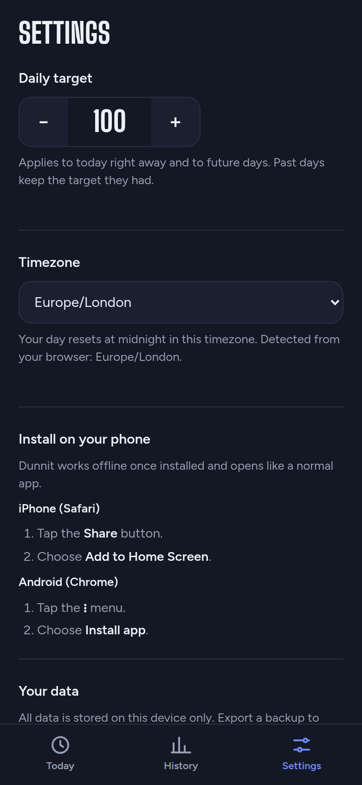

# Dunnit

Dunnit is a simple daily pushup tracker. Set a daily target (100 by default), log your reps as you do them through the day, and see how each day measured up.

It runs entirely in your browser. There is no account, no server and no database. Your data stays on your device. Dunnit installs as an app on your phone's home screen and works offline.

| | Today | History | Settings |
|---|---|---|---|
| **Light** |  |  |  |
| **Dark** |  |  |  |

## Features

- **Today:** a progress ring shows reps done against the day's target. Log a set in one tap with +5, +10 or +25 (the three amounts are configurable in Settings), or type any amount. Each set is listed with its time and can be deleted, with undo.
- **History:** a 7 or 30 day chart of reps per day, with each day's target drawn as a dashed line, plus a day-by-day table. A 90 day range appears once you have more than 30 days of history, and a 1 year range (weekly averages) once you have more than 90.
- **Settings:** change the daily target and timezone, see how to install the app, and export, import or reset your data.
- **Light and dark mode** follow your device setting.
- **Installable and offline:** add it to your home screen on iPhone or Android, or install it from Chrome on desktop.

### How days and targets work

- A day runs from midnight to midnight in your chosen timezone. The timezone starts as the one your browser reports.
- Each day keeps the target it had. Changing the target applies to today right away and to future days, but never to past days.
- Changing timezone never moves sets you've already logged to a different day.

### Your data

Everything is stored in your browser's local storage on this device. Clearing your browser's site data deletes it. To keep a backup or move to another device, use **Export** in Settings, which saves a JSON file, and **Import** on the other device.

## Development

You need [Node.js](https://nodejs.org/) 22.22 or later (or 24.15 or later on Node 24).

```sh
npm install
npm run dev        # start the dev server at http://localhost:5173
```

### Tests

```sh
npm test           # run all tests once (Vitest + React Testing Library)
npx vitest         # re-run tests on every change
```

### Build

```sh
npm run build      # type-check and build to dist/
npm run preview    # serve the build at http://localhost:4173
```

The service worker that makes the app work offline only runs in the production build. Use `npm run preview` to test installing and offline use.

### Deploying

`dist/` is a static site. Upload it to any static host, such as GitHub Pages, Netlify or Cloudflare Pages. Browsers only allow installing the app and the offline service worker over HTTPS (or on `localhost`).

The build assumes the app is served from the root of a domain. To serve it from a sub-path, such as `https://user.github.io/dunnit/`, set [`base`](https://vite.dev/config/shared-options.html#base) in `vite.config.ts`.

### Project layout

```
src/
  days.ts            data model and day/target logic (pure functions)
  storage.ts         localStorage, export and import validation
  useData.ts         React hook that holds and saves app state
  screens/           Today, History and Settings
  components/        progress ring and history chart
public/icons/        app icons
```

Built with React, TypeScript, Vite and vite-plugin-pwa.

## License

[MIT](LICENSE)
